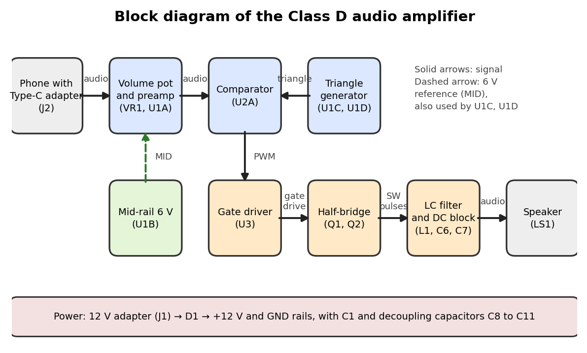

# Class D Audio Amplifier (no microcontroller)

Mini project for 21ECC211L Devices and Digital IC Lab, SRM Institute of Science and Technology.

A Class D audio amplifier built from analog parts only. Audio from a phone is turned into PWM by a comparator and a triangle wave, two MOSFETs switch a 12 V supply with that PWM, and an LC filter returns the audio to a 4 ohm speaker.

## How it works
1. **Modulation:** a TL074 preamp and a 55 kHz triangle generator feed a KA393 (LM393) comparator, which outputs PWM.
2. **Switching:** an IR2104 gate driver (with bootstrap and dead time) drives two IRLZ44N MOSFETs in a half-bridge.
3. **Demodulation:** a 47 uH / 1 uF LC filter and a 1000 uF DC-blocking capacitor feed the speaker.

Full schematic: [circuit/complete_circuit_diagram.png](circuit/complete_circuit_diagram.png)

## Main parts
| Part | Role |
|---|---|
| TL074 (U1) | preamp, 6 V mid-rail buffer, Schmitt trigger, integrator |
| KA393 / LM393 (U2) | comparator, makes the PWM |
| IR2104 (U3) | half-bridge gate driver with bootstrap |
| IRLZ44N x2 (Q1, Q2) | high-side and low-side switches |
| L1 47 uH, C6 1 uF, C7 1000 uF | output filter and DC block |
| 12 V adapter, 1N5819 | supply and reverse protection |

## Design numbers
Carrier f = R7 / (4 R6 R8 C4) = 55 kHz. Filter cut-off 23 kHz. Ideal gain Vs / (2 Vtri) = 2.9. In the ngspice simulation the carrier is about 52 kHz because of op-amp delay.

## Simulation
See [simulation/](simulation/) for the ngspice netlists and plots. These are simulation results, not measurements.

## Hardware status
Breadboard prototype (see `photos/`). The 6 V mid-rail, the preamp and the comparator stages have been tested; the gate driver and MOSFET output stage are still being debugged. *(Edit this section as the build progresses.)*

## Repository layout
- `report/` mini project report (Word)
- `circuit/` block diagram and complete circuit diagram
- `simulation/` ngspice netlists, run script and result plots
- `docs/` breadboard build guide and parts list
- `photos/` breadboard photo

## References
Sedra and Smith, *Microelectronic Circuits*; Horowitz and Hill, *The Art of Electronics*; Texas Instruments application reports SLOA031, SLOA145 and SLAA701; International Rectifier / Infineon AN-978 and the IR2104 and IRLZ44N datasheets.
